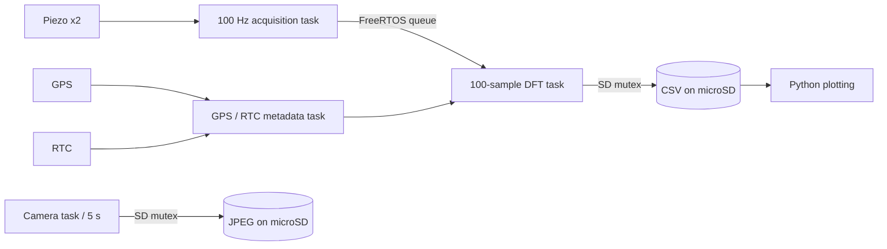

# 1U CubeSat Vibration-Sensing Engineering Model

Team-built 1U CubeSat engineering-model project focused on low-frequency vibration sensing and embedded subsystem integration. My contribution focused on firmware development and subsystem integration.

The current implementation combines dual-channel piezoelectric sensing, FreeRTOS task scheduling, direct-DFT dominant-frequency estimation, SD-card logging, RTC/GPS metadata, periodic camera capture, and a Python plotting workflow.

> **Engineering scope:** This is an engineering demonstrator, not qualification hardware. The repository does not claim calibrated acceleration, qualification-level launch vibration measurement, or verified structural modal frequencies.

## Project overview

The firmware:

- samples two piezoelectric input channels every 10 ms (nominal 100 Hz),
- sends samples through a FreeRTOS queue to separate acquisition from processing,
- processes 100-sample windows with a direct Discrete Fourier Transform (DFT),
- logs the dominant non-DC frequency bin and magnitude for each channel to microSD,
- adds RTC date/time and GPS latitude/longitude metadata,
- captures a JPEG image every 5 seconds,
- uses mutexes to protect shared metadata and SD-card access,
- supports host-side plotting of the logged dominant-frequency and magnitude data.

## My contribution

My work on the team project focused on coding and subsystem integration. This repository documents the firmware and data-processing portion of that work, with the current source organized into acquisition, processing/logging, camera, and GPS/RTC tasks.

## System architecture



More detail: [`docs/system_architecture.md`](docs/system_architecture.md)

## Repository layout

```text
.
├── firmware/
│   └── MyCubeSat/
│       ├── MyCubeSat.ino
│       ├── Global.h
│       ├── Task_Sensors.cpp
│       ├── Task_Processing.cpp
│       └── Task_Camera.cpp
├── analysis/
│   ├── plot_vibration.py
│   └── requirements.txt
├── tests/
│   ├── validate_dft.py
│   └── fixtures/
│       └── synthetic_dft_log.csv
├── results/
│   └── synthetic/
├── data/
│   └── README.md
└── docs/
    ├── system_architecture.md
    ├── technical_notes.md
    └── development_history.md
```

## Signal-processing configuration

| Parameter | Current value |
|---|---:|
| Sampling frequency | 100 Hz |
| Samples per DFT window | 100 |
| Approx. window duration | 1 s |
| Frequency-bin spacing | 1 Hz |
| Theoretical Nyquist frequency | 50 Hz |
| Bins evaluated by the current code | 1–49 Hz |

The firmware uses a **direct DFT**, not an FFT library. The current implementation does not apply a window function, and `Mag1` / `Mag2` are based on ADC-count data rather than calibrated acceleration units. See [`docs/technical_notes.md`](docs/technical_notes.md).

## FreeRTOS task structure

| Task | Function | Trigger / period | Priority | Core |
|---|---|---|---:|---:|
| A | Dual piezo acquisition | 10 ms | 3 | 0 |
| D | GPS parsing + RTC metadata cache | continuous / 1 s cache update | 0 | 0 |
| B | DFT + CSV logging | every 100 queued samples | 2 | 1 |
| C | Camera capture | 5 s | 1 | 1 |

A queue separates acquisition from DFT/logging. Separate mutexes serialize SD-card access and protect the shared RTC/GPS metadata cache.

## Firmware environment

The sketch targets the ESP32 Arduino environment and uses:

- `esp_camera`
- `FS` / `SD_MMC`
- `EEPROM`
- `Wire`
- `RTClib`
- `TinyGPSPlus`
- FreeRTOS APIs provided by the ESP32 Arduino platform

The exact board package and library versions are not pinned in this repository. The project-specific pin map is defined in `firmware/MyCubeSat/Global.h` and should be checked against the physical hardware before flashing.

## Host-side plotting

Create a Python environment and install the analysis dependencies:

```bash
python -m venv .venv
# activate the environment for your OS
pip install -r analysis/requirements.txt
```

Plot a compatible log file:

```bash
python analysis/plot_vibration.py path/to/vibration_data_dft.csv \
  --output results/vibration_plot.png
```

The plotting path can also be exercised with the synthetic fixture:

```bash
python analysis/plot_vibration.py tests/fixtures/synthetic_dft_log.csv \
  --output results/synthetic/synthetic_plot.png
```

## DFT software check

`tests/validate_dft.py` reproduces the firmware's peak-picking logic using synthetic sine-wave inputs. It checks 5, 10, 20, 35 and 45 Hz signals aligned to the 1 Hz DFT bins.

```bash
python tests/validate_dft.py
```

These checks validate the software logic only; they are not hardware vibration-test results. Generated outputs are kept under [`results/synthetic/`](results/synthetic/).

## Data and test evidence

Measured hardware vibration data is not published in this repository at this time. The synthetic fixture under `tests/fixtures/` exists only for software validation and plotting checks.

When measured data is published, it should be accompanied by enough test context to interpret it correctly, such as sensor location/mounting, excitation method, acquisition duration, and whether the values are raw ADC counts or calibrated engineering units.

## Development history

The project progressed from a polling implementation with frequent SD writes, through buffered logging, to a FreeRTOS multi-task design and the current modular source layout. This repository keeps the current modular implementation so the public codebase remains focused. See [`docs/development_history.md`](docs/development_history.md).

## Current limitations

- Sampling is nominally 100 Hz, so the design targets relatively low-frequency content.
- The direct DFT evaluates bins 1–49 Hz and logs only the dominant non-DC bin.
- No window function is applied before the DFT.
- The repository does not include a calibration from ADC counts to acceleration or force units.
- No hardware-level timing benchmark is included.
- The repository should therefore be treated as an engineering demonstrator rather than a qualification-level vibration measurement system.
