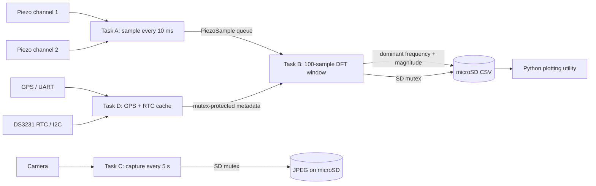

# System Architecture

The current firmware is organized around four FreeRTOS tasks and two synchronization paths: a sample queue for piezo data and mutexes for shared resources.

## FreeRTOS allocation

| Task | Function | Period / trigger | Priority | Core |
|---|---|---|---:|---:|
| A | Dual piezo acquisition | 10 ms | 3 | 0 |
| D | GPS parsing + RTC metadata cache | continuous / 1 s cache update | 0 | 0 |
| B | DFT + CSV logging | every 100 queued samples | 2 | 1 |
| C | Camera capture | 5 s | 1 | 1 |

### Data flow

1. Task A samples both piezo channels and sends `PiezoSample` records to `piezoQueue`.
2. Task B receives 100 samples, performs a direct DFT independently on both channels, and selects the largest non-DC bin.
3. Task D continuously parses GPS serial data and updates a shared RTC/GPS metadata string once per second.
4. Task B combines the DFT result with the current metadata and appends one CSV row to microSD.
5. Task C captures a JPEG every 5 seconds and writes it to the same SD card.
6. `sdMutex` serializes camera and CSV writes, while `dataMutex` protects the shared metadata cache.
